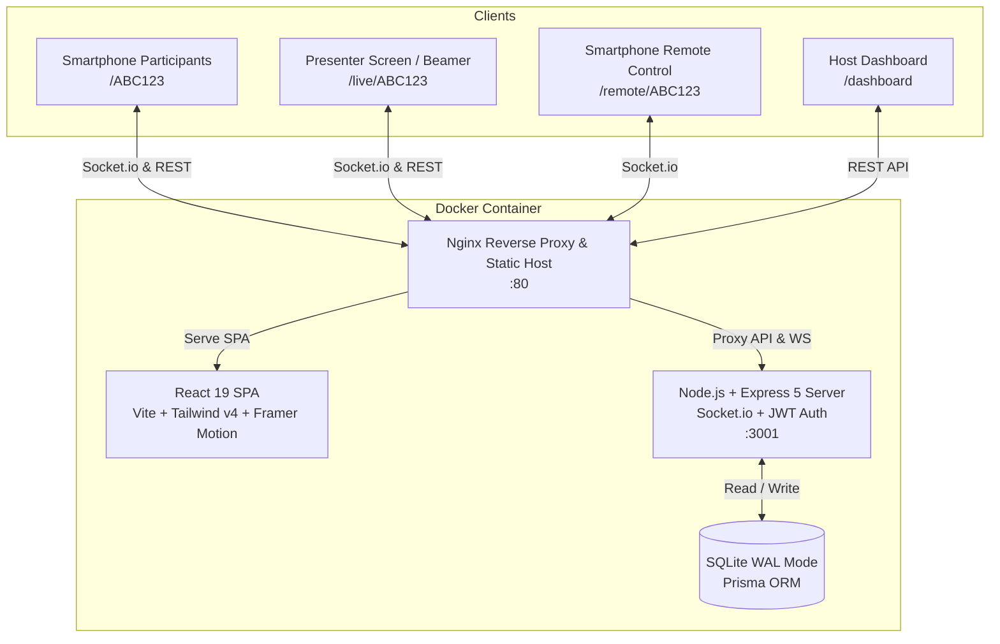

# Pulse - Feel the Pulse

[](LICENSE)
[](docker-compose.yml)
[](frontend/src/i18n.js)
[-2D3748.svg?logo=prisma&logoColor=white)](backend/prisma/schema.prisma)

Pulse is a 100% free, lightweight, and self-hosted web application for running interactive live sessions like polls, Q&A, rankings, ratings, and wordclouds. It is built for speed, real-time interactivity, and strict GDPR compliance without any user limits or hidden costs.

---

## Architecture Overview



---

## Features

* **Free & Unlimited:** No subscription fees, no limits on participants or sessions.
* **Privacy First & GDPR Compliant:** Self-hosted on your own infrastructure. No third-party tracking, no advertising cookies, no external analytics.
* **Multi-Language Support (i18n):** Native bilingual support in **English** and **German** with automatic browser language detection and instant in-app switching.
* **Built-in Compliance & Legal Notice:** Integrated accessible modals for Imprint (§ 5 DDG) and Privacy Policy (GDPR / DSGVO), fully customizable or overridable via `.env`.
* **Real-Time Synchronization:** Uses Socket.io to push results instantly to all connected screens with automatic client reconnects.
* **Multiple Session Types:**
  * **Wordcloud:** Dynamic sizing based on frequency with Archimedean spiral positioning, sentence-splitting, and stop-word filtering.
  * **Poll:** Classic single-choice live poll with animated percentage distributions.
  * **Ranking:** Prioritization and drag-and-drop sorting by participants.
  * **Rating:** 5-Star scale evaluation for multiple criteria.
  * **Q&A:** Audience questions with real-time upvotes, moderator deletion, and moderation schema readiness.
  * **Open Ended:** Free-text brainstorming with real-time tile layout.
* **Presenter Remote Control:** Control the presentation view directly from your smartphone via secure QR-code pairing (`/remote/:code`) — pause sessions, toggle timers, show/hide results, and trigger floating emojis.
* **Live Reactions (Emoji Rain):** Allow participants to send live reactions (👍, ❤️, 🎉, 🔥, 👏) that float dynamically across the presenter's screen.
* **PDF Report Export:** Print-optimized report page (`/live/:code/report`) with clean CSS print styles to export session summaries directly to PDF.
* **Session Timer:** Hosts can set a live countdown that automatically locks the session when time expires.
* **Data Export:** Download session results instantly as CSV files.
* **Interactive Onboarding:** Built-in product tours guide new hosts through the dashboard and live views.
* **High-Performance Architecture:** SQLite in Write-Ahead Logging (`WAL`) mode with sliding-window rate limiters on WebSockets and REST endpoints.

---

## Tech Stack

* **Frontend:** React 19, Vite, Tailwind CSS v4, Framer Motion, Recharts, `react-i18next`, Lucide Icons
* **Backend:** Node.js, Express 5, Socket.io, Prisma 6 (SQLite with WAL), JWT Authentication, Helmet
* **Infrastructure:** Docker & Docker Compose (Multi-stage build with alpine Nginx)

---

## Quick Start (Docker Compose)

### 1. Clone the repository
```bash
git clone https://github.com/thefraggle/pulse.git
cd pulse
```

### 2. Configure Environment Variables
Pulse includes sensible defaults, but in production you should set your own `ADMIN_PASSWORD` and `JWT_SECRET`:

```bash
# Backend variables
cp backend/.env.example backend/.env

# Frontend variables
cp frontend/.env.example frontend/.env
```

### 3. Start the Application
```bash
docker compose up -d --build
```

### 4. Access Pulse
* **Participant View:** `http://localhost/`
* **Host Dashboard:** `http://localhost/dashboard` (Default login: `admin` / your configured `ADMIN_PASSWORD`)

---

## Legal & Privacy Notice Customization (White-Labeling)

Pulse includes built-in, DSGVO-compliant legal and privacy modals. If you operate an official organization and prefer linking your external legal pages, simply define:

```bash
# In frontend/.env:
VITE_IMPRESSUM_URL=https://yourcompany.com/imprint
VITE_PRIVACY_POLICY_URL=https://yourcompany.com/privacy
```

---

## Contributing & Security

* For code guidelines and pull request instructions, see [CONTRIBUTING.md](CONTRIBUTING.md).
* For reporting security vulnerabilities, please refer to [SECURITY.md](SECURITY.md).

---

## License

[MIT License](LICENSE) - Copyright (c) 2026 Daniel Notthoff
